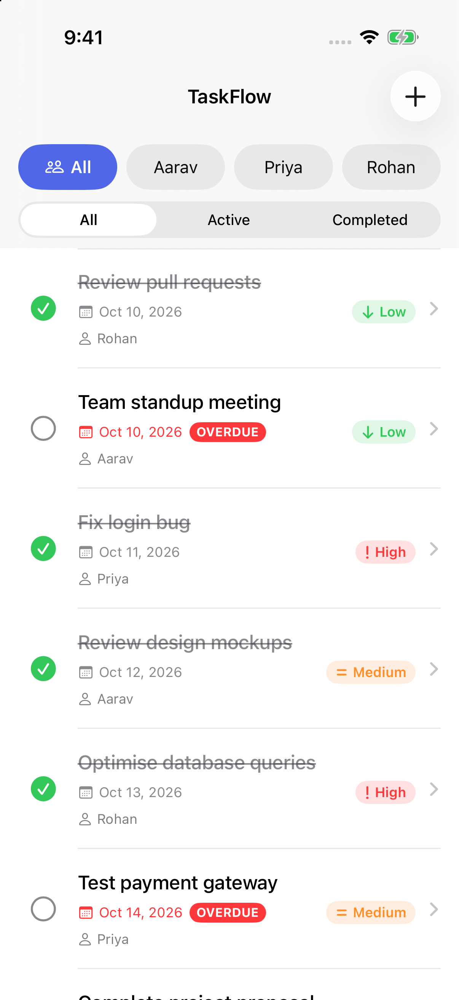
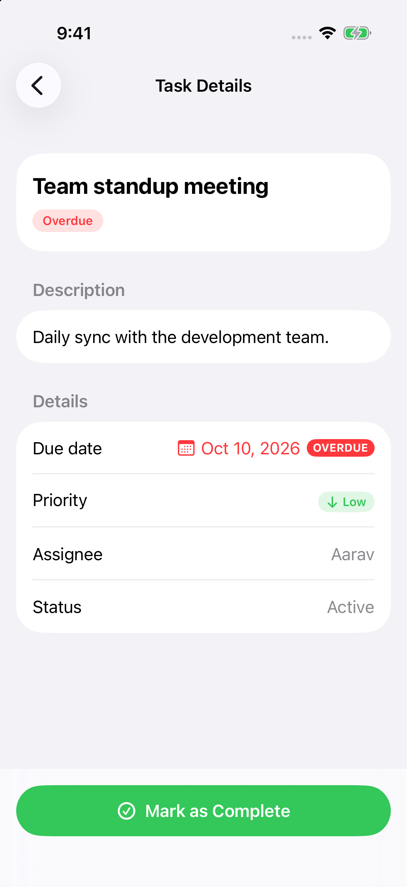
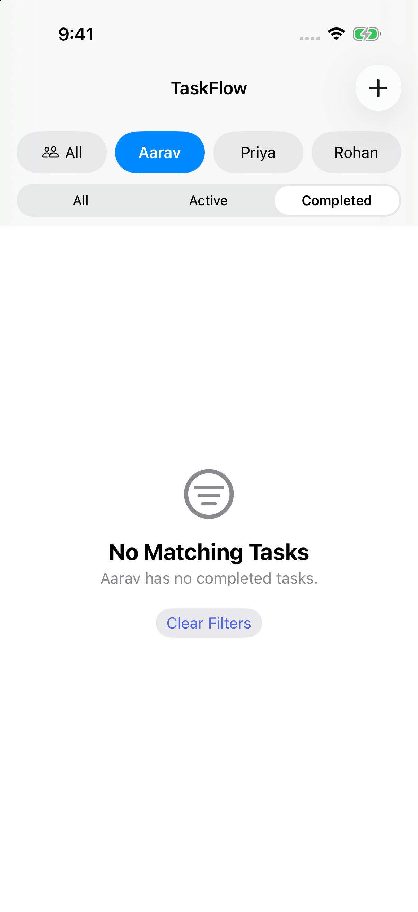
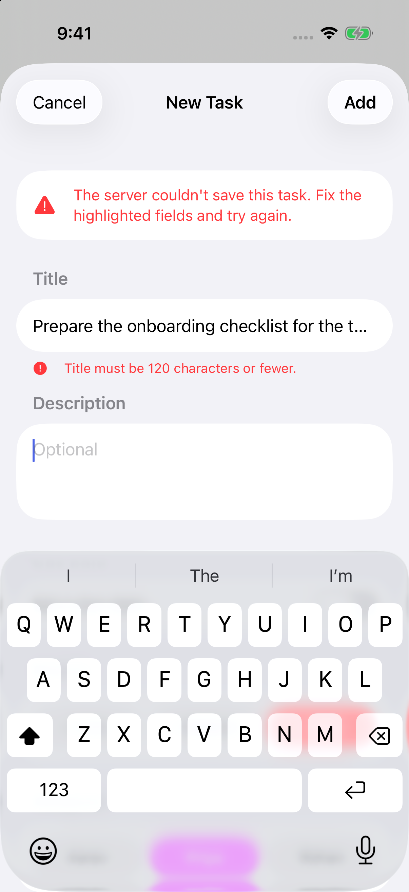
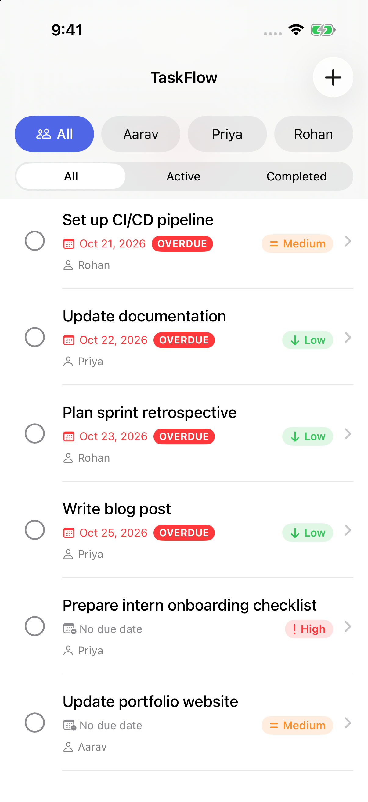

# TaskFlow

A minimal mobile task manager: a native SwiftUI iOS app backed by a Swift (Vapor) REST API with SQLite storage. Two screens, one add-task form, and the four mandatory edge cases handled end to end.

Demo video: [`docs/TaskFlow-demo.mp4`](docs/TaskFlow-demo.mp4) (98 seconds, recorded on the iPhone 17 Pro simulator against the local backend).

## 1. How to Run Locally

### Technology stack

| Layer | Choice | Why |
| --- | --- | --- |
| iOS app | Swift 6, SwiftUI, Observation (`@Observable`), MVVM, `URLSession` with async/await | Native iOS is my primary platform; SwiftUI + Observation keeps view state small and testable, and there are no third-party dependencies in the app. |
| Backend | Swift 6, Vapor 4.122, Fluent 4.13, SQLite (`fluent-sqlite-driver` 4.9) | Same language on both sides, typed request/response models, and SQLite needs no database server to install. |
| Tests | XCTest + XCTVapor (backend, 18 tests), Swift Testing (iOS, 27 tests) | Cover the API contract, validation, filtering, overdue logic, optimistic rollback, and server-error mapping. |

### Requirements

- macOS with **Xcode 16 or later** (built and tested with Xcode 26.6 / Swift 6.3)
- An iOS 17+ simulator
- Internet access on the first backend build (Swift Package Manager downloads Vapor)

### 1. Start the backend

```bash
cd Backend
swift run App serve --hostname 127.0.0.1 --port 8080
```

The first build takes a few minutes. On startup the server runs its migrations, creates `Backend/db.sqlite`, and seeds the 15 tasks from [`Backend/Sources/App/Resources/seed.json`](Backend/Sources/App/Resources/seed.json) (the data provided in the brief, unchanged). To reset to the seed data, stop the server and delete `Backend/db.sqlite`.

Quick check:

```bash
curl "http://localhost:8080/api/tasks?assignee=aarav&status=completed"
```

### 2. Run the iOS app

1. Open `iOS/TaskFlow.xcodeproj` in Xcode.
2. Select the **TaskFlow** scheme and any iPhone simulator.
3. Press **Run** (⌘R). The simulator reaches the backend at `http://localhost:8080`.

### 3. Run the tests

```bash
cd Backend && swift test
```

```bash
cd iOS && xcodebuild test -project TaskFlow.xcodeproj -scheme TaskFlow -destination 'platform=iOS Simulator,name=iPhone 16'
```

(Or press ⌘U in Xcode. Replace the simulator name with one installed on your machine.)

### Environment variables

| Variable | Where | Default | Purpose |
| --- | --- | --- | --- |
| `DATABASE_PATH` | Backend | `db.sqlite` | SQLite file location. Tests always use an in-memory database. |
| `API_BASE_URL` | iOS build setting **or** scheme environment variable | `http://localhost:8080` | Backend URL used by the app. |

To run on a physical iPhone, start the backend with `--hostname 0.0.0.0`, set `API_BASE_URL` to `http://<your-mac-ip>:8080` in the TaskFlow target's build settings, and pick your signing team.

### API

| Method | Path | Description |
| --- | --- | --- |
| `GET` | `/api/tasks` | All tasks, sorted by due date (tasks without a date last). Optional `assignee=aarav\|priya\|rohan` and `status=active\|completed`, combinable. Unknown values return `400`. |
| `POST` | `/api/tasks` | Creates a task and returns `201`. Validates title (required, trimmed, ≤ 120 chars), priority, assignee, and `dueDate` (`YYYY-MM-DD`, a real calendar date, or `null`). |
| `PATCH` | `/api/tasks/:id/toggle` | Flips `completed` and returns the updated task. `400` for a malformed id, `404` for an unknown one. |
| `GET` | `/health` | Liveness check. |

Every error response has the same shape, so the app can attach messages to individual form fields:

```json
{
  "error": true,
  "reason": "Validation failed.",
  "fieldErrors": {
    "title": "Title is required.",
    "priority": "Priority must be one of: low, medium, high."
  }
}
```

## 2. Screen Structure

**Task List → Task Detail → Back to Task List (filters preserved)**, with **Task List → Add Task (sheet) → Task List**.

| Task list | Task detail | Combined filters, no results | Server validation error | Tasks without a due date |
| --- | --- | --- | --- | --- |
|  |  |  |  |  |

**Task List.** Assignee chips (All / Aarav / Priya / Rohan) and a status segmented control (All / Active / Completed) work together. Each row shows the title, due date, priority badge, assignee and a completion checkbox; tapping the checkbox or swiping right toggles completion. Includes loading, error (with Retry), empty, and no-match states, plus pull-to-refresh. **+** opens the Add Task form.

**Task Detail.** Shows every field and a full-width **Mark as Complete / Mark as Incomplete** button that calls the toggle endpoint.

**Add Task.** Title, description, due date (optional toggle plus a calendar picker), priority chips, and assignee chips. **Add** stays disabled until the form is valid. Server validation errors appear under the matching field and in a summary banner, and clear as soon as you edit that field.

### Edge cases

| Case | Behaviour |
| --- | --- |
| **Task without a due date** | Shows "No due date" in grey with a calendar-minus icon, sorts to the bottom of the list, and is never overdue: the overdue check returns `false` when there is no parsable date. |
| **Overdue but completed** | **No overdue indicator.** A finished task needs no action, so a red badge would only add noise and dilute the warning on tasks that are actually late. The date stays visible in grey; reopening the task brings the overdue badge back. The same rule (`!completed && dueDate < today`) is used in the list and on the detail screen. |
| **Combined filters with no results** | Shows "No Matching Tasks" with a sentence naming the filters (for example, "Aarav has no completed tasks.") and a **Clear Filters** button. It is shown only after loading finishes, so it never flashes during a request. |
| **Server validation error** | The `fieldErrors` map is matched to form fields; any message with no matching field goes in the banner. Titles over 120 characters are checked only on the server, which makes this path easy to try from the app. |

Overdue means the due date is **before today in the device's local calendar**: a task due today is not overdue. Due dates are kept as plain `YYYY-MM-DD` calendar days and are never converted through UTC (see Bug Hunt).

## 3. Decision 1 — Optimistic vs. Pessimistic

**Optimistic.** Ticking a checkbox is a frequent, low-risk action that users expect to respond instantly, so the UI flips immediately and rolls back with an alert and an error haptic if the server rejects the change.

Implementation notes: the control is disabled while its request is in flight because the toggle endpoint is not idempotent (a double tap would otherwise send two flips), and a list refresh that arrives mid-toggle keeps the local value instead of overwriting it.

## 4. Decision 2 — Filter Persistence

**Filters are preserved.** The user picked them to narrow the list down to what they are working on, so returning from a task should land them back where they were; the filter state lives in the list's view model, which outlives the navigation push.

Filters are kept for the app session only, not across launches, and returning from the detail screen does not trigger an extra network request.

## 5. Bug Hunt

```js
function isTaskOverdue(task) {
  const today = new Date().toISOString().split('T')[0];
  return task.dueDate < today;
}
```

**Bug 1 — Timezone.** `toISOString()` returns the date in **UTC**, not the user's local date, so "today" is wrong for part of every day: in India (UTC+5:30) between midnight and 5:30 am it is still yesterday, so tasks due yesterday are not flagged yet, and in the US in the evening it is already tomorrow, so tasks due today are flagged overdue too early.

**Bug 2 — Silent failure on missing or invalid data.** The function compares strings without checking them, so bad data never raises an error and just produces a wrong answer: `null` and `undefined` happen to return `false` through type coercion, an empty string returns `true`, and a non-padded or differently formatted date such as `"2026-9-5"` or `"15/10/2026"` is compared character by character and gives an arbitrary result.

TaskFlow avoids both. [`CalendarDay`](iOS/TaskFlow/Models/CalendarDay.swift) strictly parses `YYYY-MM-DD` into a real calendar date (invalid input becomes `nil`), "today" comes from the device's local calendar, and [`TaskItem.isOverdue`](iOS/TaskFlow/Models/TaskItem.swift) returns `false` for completed tasks or when there is no valid date. Unit tests cover each of these cases, including a UTC-versus-IST test.

## 6. AI Usage

**Tool used:** Claude Code (Anthropic's AI coding assistant).

**What I asked it to generate:**

- The Vapor backend: model, migration, seeding from the provided JSON, the three endpoints, validation, the error format, and XCTVapor tests.
- The SwiftUI app: MVVM structure, networking layer, list, detail and add-task screens, reusable components, and Swift Testing unit tests.
- The hand-written Xcode project file, the app icon (drawn with a small CoreGraphics script), and a first draft of this README.

**What was verified, and how:**

- Both projects built from the command line with no warnings in project code; all 18 backend tests and 27 iOS tests pass.
- The endpoints were exercised with `curl`, including combined filters and a `400` validation response.
- The app was run on the iOS simulator against the real backend, checking each edge case: an undated task, a completed overdue task, Aarav + Completed with no results, and a too-long title rejected by the server.
- That manual run found three issues that were then fixed: the large navigation title rendered blank above the filter bar, labels inside list rows were spread too wide, and the form's error banner kept a stale "Validation failed." after the field error was corrected (a regression test was added for the last one).
